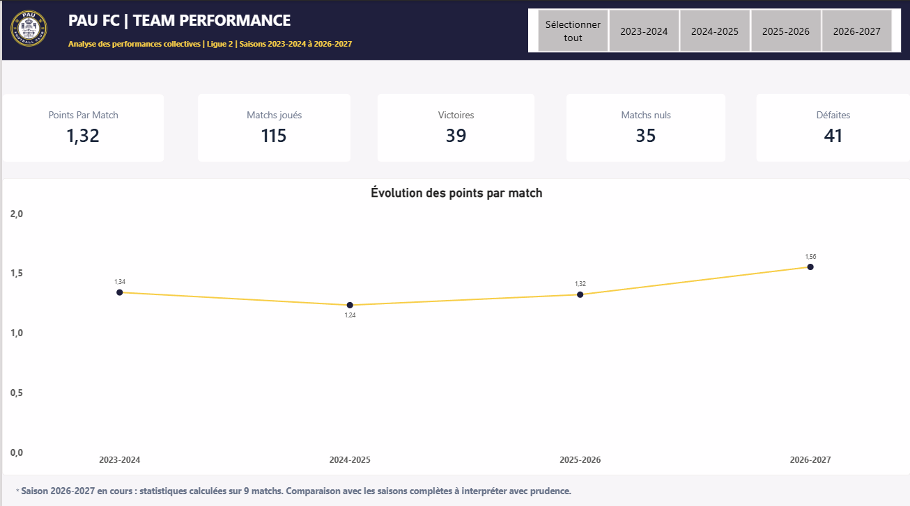
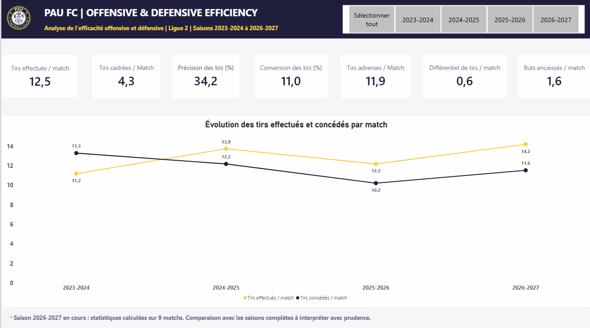
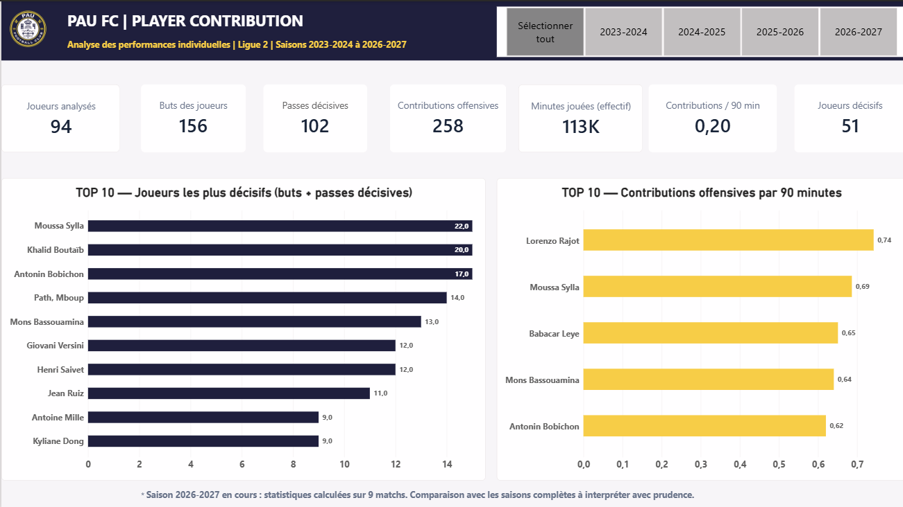
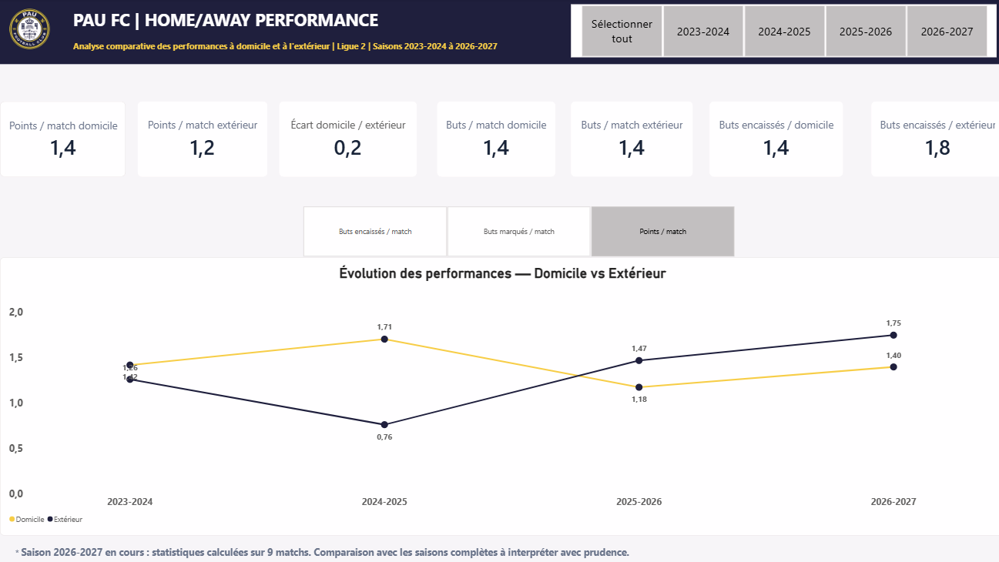
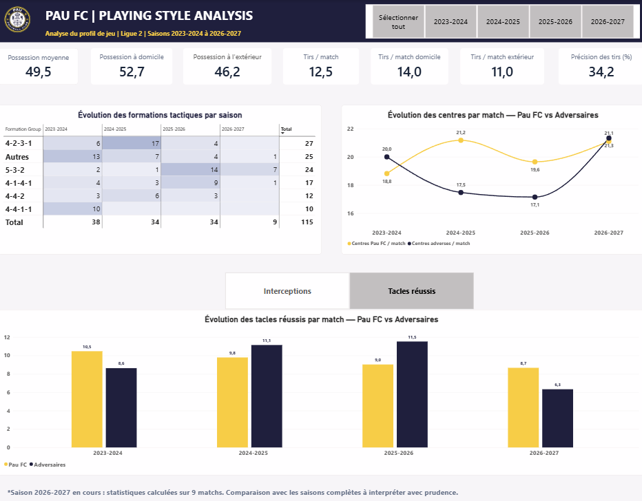

# Pau FC — Football Performance Intelligence

**End-to-End Football Analytics | Python · PostgreSQL · Docker · dbt Core · Power BI**

An end-to-end football analytics project designed to transform historical match and player statistics into structured, reliable, and actionable insights for football performance analysis.

The project focuses on **Pau FC**, competing in French Ligue 2, across four seasons from **2023–2024 to 2026–2027** (the final season is ongoing).

## Project Overview

The objective is to build a reproducible analytics pipeline combining data engineering, data modeling, business intelligence, and football performance analysis.

The project explores five analytical dimensions:

1. Team Performance
2. Offensive & Defensive Efficiency
3. Player Contribution
4. Home vs Away Performance
5. Playing Style Analysis

The dashboard supports descriptive performance assessment and highlights questions that can be investigated further through tactical analysis and video review.

## Data Architecture

```text
Football Data Sources
FBref | Football-Data.co.uk
          |
          v
      Raw CSV Files
          |
          v
  Python Data Processing
  Cleaning | Validation
          |
          v
 PostgreSQL 16 + Docker
          |
          v
        dbt Core
  Staging | Marts | Tests
          |
          v
       Power BI
    Five Dashboard Pages
          |
          v
 Football Decision Support
```

The architecture separates data ingestion, transformation, analytical modeling, and visualization.

## Technology Stack

| Technology | Purpose |
|---|---|
| Python | Data cleaning, validation, and loading |
| PostgreSQL 16 | Relational data storage |
| Docker | Local database infrastructure |
| SQL | Data transformation and analytical queries |
| dbt Core | Data modeling, testing, and documentation |
| Power BI | Interactive dashboard and KPI visualization |
| Git & GitHub | Version control and project documentation |

## Dataset

The analysis covers:

- **115 Pau FC matches**
- **Four Ligue 2 seasons**
- **94 distinct players represented in the dashboard**
- Match results, shooting statistics, goalkeeping data, player statistics, and additional team performance indicators

| Season | Matches |
|---|---:|
| 2023–2024 | 38 |
| 2024–2025 | 34 |
| 2025–2026 | 34 |
| 2026–2027 | 9 |
| **Total** | **115** |

**Data sources:** [FBref](https://fbref.com/) and [Football-Data.co.uk](https://www.football-data.co.uk/).

The original and processed datasets are not included in this public repository while redistribution permissions are being assessed.

**Important:** The 2026–2027 season is incomplete. Comparisons involving this season should be interpreted cautiously.

## Power BI Dashboard

The Power BI dashboard is organized into five interactive pages, with season filters to support comparisons over time.

### 1. Team Performance



Overview of results, points per match, wins, draws, losses, and seasonal performance trends.

**Key metrics:**

- 115 matches analyzed
- 39 wins, 35 draws, and 41 losses
- 1.32 points per match

### 2. Offensive & Defensive Efficiency



Analysis of shot production, shot accuracy, conversion rates, and opposition shooting volume.

**Key metrics:**

- 12.5 shots per match
- 4.3 shots on target per match
- 34.2% shooting accuracy
- 11.0% shot conversion rate
- +0.6 shot differential per match

A positive shot differential does not necessarily imply superior chance quality. Additional metrics such as expected goals would be useful for deeper evaluation.

### 3. Player Contribution



Individual attacking contribution analysis, including total goals, assists, and contributions per 90 minutes.

**Key metrics:**

- 94 players analyzed
- 156 goals
- 102 assists
- 258 attacking contributions

The dashboard distinguishes cumulative production from playing-time-adjusted contribution rates.

Player comparisons should also account for minutes played, tactical roles, and sample sizes.

### 4. Home vs Away Performance



Comparison of team performance at home and away across the analyzed seasons.

**Key findings:**

- 1.4 points per match at home versus 1.2 away
- 1.4 goals scored per match in both contexts
- 1.4 goals conceded per match at home versus 1.8 away

The defensive difference is a potential area for further investigation, rather than proof of a causal explanation.

### 5. Playing Style Analysis



Exploration of possession, shooting patterns, tactical formations, crosses, and defensive actions.

**Key metrics:**

- 49.5% average possession
- 52.7% possession at home
- 46.2% possession away
- 14.0 shots per home match versus 11.0 away

The dashboard also highlights changes in formation usage across seasons, including the prominence of the 4-2-3-1 in 2024–2025 and the 5-3-2 in 2025–2026.

Formation frequency is descriptive and should not be interpreted as a complete explanation of tactical intent.

## Data Modeling

The project follows a layered dbt approach:

**Staging layer**

Standardizes source data and prepares match, player, shooting, goalkeeping, and other statistical datasets.

**Analytics layer**

The analytical marts include:

- `fct_match_performance` — Match-level team performance
- `fct_player_performance` — Player-season performance
- `fct_team_performance` — Aggregated team performance

These models provide structured data for Power BI reporting and performance analysis.

## Data Quality

Data quality is supported through Python validation scripts and dbt tests.

Checks include match-level integrity, player contribution consistency, uniqueness of player-season combinations, and other model-level constraints.

**Last validated dbt run:**

```text
PASS=37 WARN=0 ERROR=0 SKIP=0 NO-OP=0
```

This result refers to a successful local execution; automated CI validation is planned.

## Repository Structure

```text
pau-fc-football-analytics/
├── data/                  # Local datasets (not published)
├── scripts/               # Python cleaning and loading scripts
├── dbt/
│   └── pau_fc_analytics/
│       ├── models/
│       │   ├── staging/
│       │   └── marts/
│       └── tests/
├── powerbi/
│   └── Pau_FC_Football_Performance_Intelligence.pbix
├── docs/
│   └── screenshots/
├── docker-compose.yml
├── requirements.txt
└── README.md
```

## Running the Project Locally

The project requires Python, Docker, PostgreSQL connectivity, and dbt Core.

A typical local workflow consists of:

1. Obtain the source datasets from the original providers, subject to their usage conditions.
2. Configure and start the PostgreSQL Docker environment.
3. Install Python dependencies from `requirements.txt`.
4. Run the relevant Python cleaning and loading scripts.
5. Configure the local dbt PostgreSQL profile.
6. Execute dbt models and tests.
7. Open the Power BI report and configure the local data connection if necessary.

Example commands for the modeling stage:

```bash
cd dbt/pau_fc_analytics
dbt run
dbt test
```

The exact ingestion sequence and environment-specific settings should be checked against the local scripts and configuration before attempting full reproduction.

## Limitations

- The 2026–2027 season contains only nine matches at the time of analysis.
- Some performance indicators depend on the coverage and definitions of the original data providers.
- Aggregate statistics alone cannot fully explain tactical decisions or player responsibilities.
- Player comparisons should account for playing time, positions, team context, and opposition strength.
- The repository does not currently provide public copies of the source datasets.

Football data analysis is most valuable when combined with video, tactical context, and expert observation.

## Future Improvements

- Automated validation through GitHub Actions
- Additional contextual and advanced performance metrics where reliable data is available
- Improved reproducibility and environment documentation
- Further player profiling and recruitment-oriented analysis
- Video-assisted tactical interpretation

## Author

**Tarek Ben Mohamed**

Data Analyst | Analytics Engineering | Football Analytics

[GitHub](https://github.com/Tarekbenm)

---

*Independent portfolio project. Not affiliated with or endorsed by Pau FC.*